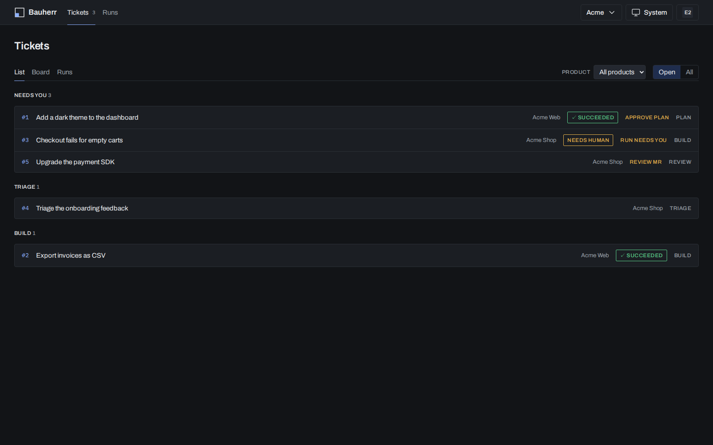
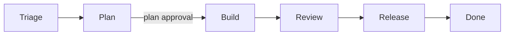

<p align="center">
  
</p>

**An open-source AI software factory. Agents take your tickets through gated stages; you approve the plan, not every keystroke.**

*Bauherr* is German for the person who commissions a building and signs off on the work, not the one who lays the bricks. That is the role Bauherr gives you: you decide what gets built and approve at the gates, and the factory does the work, with an audit trail and a cost per Workspace.



## What it does

Bauherr connects to the issue tracker and repositories you already use. A Ticket moves through fixed stages; at each stage an agent does the work and records what it did, and a person approves at the gates.

- Your Tickets stay in GitHub (GitLab is planned). Bauherr never owns a Ticket; it keeps a pointer and what it derives, and writes stages as labels.
- Agents run Claude Code through the Claude Agent SDK, in a fresh clone, and open a merge request with an evidence section (commands, exit codes, test results).
- Every request goes through a bundled LLM gateway with the Workspace's own provider credential and a budget.
- Everything is audited: Runs, Steps, tool calls, human touches, cost.
- It is self-hosted and needs only Docker and Postgres. No Redis, no external services.

## How it works



| Stage | Work |
|---|---|
| Triage | Dedupe hints; Bauherr moves the Ticket to Plan or closes it |
| Plan | An agent writes the plan and a decision sheet (defaults, `critical` flags) as a Comment and sets the Goal in the worklog |
| Build | An agent implements the Goal on a branch and opens a merge request with evidence |
| Review | Reviewer agent without memory of the change (planned, [#82](https://github.com/getbauherr/bauherr/issues/82)); today the merge request is reviewed in your forge |
| Release | The Product's own CI |
| Done | Ticket closed on merge |

Human gates:

- **Plan approval** (shipped): approve in the Bauherr UI, or set the label `bauherr:approved:plan` in the forge. Approval through the UI or MCP is refused while critical decisions are unanswered.
- **Merge request review** (shipped): native review and merge in your forge.
- Planned: **factory code review and auto-merge** ([#82](https://github.com/getbauherr/bauherr/issues/82)), **staging acceptance with a result summary** ([#83](https://github.com/getbauherr/bauherr/issues/83)) and a **production deploy approval** ([#84](https://github.com/getbauherr/bauherr/issues/84)). These revise the gate model so that humans approve the plan, accept the result on staging and approve the production deploy.

Stages, labels, triggers, run states, retries and budgets: [docs/spec/workflow.md](docs/spec/workflow.md).

## Key concepts

Full glossary: [CONTEXT.md](CONTEXT.md).

| Term | Meaning |
|---|---|
| Workspace | Isolation boundary for one client or organisation; owns its Connections, budget and provider credential |
| Product | A deliverable inside a Workspace, with its own Repositories, Ticket source and workflow |
| Bauherr / Admin | A Workspace member who configures the factory and approves at gates / one who runs the instance |
| Ticket | One issue in the Product's Ticket source; the source of truth |
| Run | One agent execution on exactly one Ticket; its Steps are recorded for audit and cost |
| Tier | `cheap`, `standard` or `strong`; stages pick a Tier, the Workspace maps it to a model |
| Pack | Skills, rules and hooks materialised into each Run's worktree, never committed; the open-source core pack is in [`pack/`](pack/README.md), a Workspace can layer its own Knowledge repo on top |
| Worklog | One pinned Comment per Ticket that agents read first and update last |

Runs have two modes. In **autonomous** mode the Runner spawns an agent. In **session** mode the Run waits until your own Claude Code session claims it over the factory MCP server, so you work in your local worktree with your own credentials and the factory keeps the record. The mode is set per stage and Workspace: [docs/session-mode.md](docs/session-mode.md).

## Features

- **Ticket sources**: GitHub Issues today. GitLab is designed ([#14](https://github.com/getbauherr/bauherr/issues/14)) but has no driver yet.
- **Bundled LLM gateway**: [agentgateway](https://agentgateway.dev) runs in the compose stack; each Workspace gets its own consumer key, provider credential and rolling 30-day budget in USD or tokens. An exhausted budget ends the Run.
- **Factory UI**: Tickets overview (list, board, runs) with a "Needs you" queue, Ticket page with decision sheet and plan gate, Run page with graph, timeline and list views, and settings for Workspaces, Products, Connections, Bauherren, API key, audit and workflow. [docs/ui.md](docs/ui.md)
- **MCP server for your own Claude Code**: `/mcp` exposes tools to list the frontier, claim and finish Runs, update the worklog, attach evidence and approve the plan gate. [docs/session-mode.md](docs/session-mode.md)
- **Audit and cost**: Runs, Steps, tool calls (argument names and hash, never payloads) and human touches are stored; cost is reconciled against the gateway's request log. The gateway stores no prompts.
- **Sign-in**: email and password out of the box, optional OIDC with role and Workspace mapping. [docs/auth.md](docs/auth.md)
- **Postgres only**: application data, job queue and gateway state live in one Postgres 17.

## Quick start

Requires Docker with Compose. Local development also needs Node 24 and pnpm 10.

```bash
git clone https://github.com/getbauherr/bauherr.git && cd bauherr
docker compose build && docker compose up -d
```

This starts `db` (Postgres 17), `gateway`, `app` (UI, API and MCP on `http://localhost:3000`), `worker` (agent Runs) and `poller` (Ticket source polling). Secrets are generated on first start into a volume.

Create the Admin user, the first Workspace and its Connections. The seed script currently creates Workspace `getbauherr` for the repository `getbauherr/bauherr` (workspace #0); further Workspaces, Products and Connections are edited under Settings in the UI. A setup wizard is planned.

```bash
export GITHUB_TOKEN="$(gh auth token)" BAUHERR_ADMIN_EMAIL=<email>
docker compose run --rm --no-deps -T \
  -v ~/.config/bauherr/anthropic-key:/run/anthropic-key:ro -e ANTHROPIC_API_KEY_FILE=/run/anthropic-key \
  -v ~/.config/bauherr/admin-password:/run/admin-password:ro -e BAUHERR_ADMIN_PASSWORD_FILE=/run/admin-password \
  -e BAUHERR_ADMIN_EMAIL -e GITHUB_TOKEN app sh -c 'cd /repo/apps/server && pnpm seed'
```

Open `http://localhost:3000` and sign in. To start a Ticket, label it `bauherr:stage:plan` in the forge; the poller picks it up, a plan Run posts the plan, and setting `bauherr:approved:plan` (or approving in the UI) queues the Build Run. A worked example with costs: [docs/first-run.md](docs/first-run.md).

To work on tickets from your own Claude Code session instead, create an API key in the UI (user menu, API key) and follow [docs/session-mode.md](docs/session-mode.md).

## Configuration

| What | Where |
|---|---|
| `PORT`, `PUBLIC_URL`, `BAUHERR_DISABLE_ADMIN`, `OTEL_ENABLED` | environment or `.env` next to [`compose.yaml`](compose.yaml) |
| OIDC sign-in (`OIDC_ISSUER`, `OIDC_CLIENT_ID`, ...) | [docs/auth.md](docs/auth.md) |
| Run mode per stage (`BAUHERR_DEFAULT_MODE`, Workspace `modeByStage`) | [docs/session-mode.md](docs/session-mode.md) |
| Stages, steps, gates | [`pack/workflow.yaml`](pack/workflow.yaml), [docs/spec/workflow.md](docs/spec/workflow.md) |
| Gateway providers and model catalogs | [`deploy/gateway/`](deploy/gateway) |
| Budgets, model Tiers, Connections | Settings in the UI |
| Provider credentials and data flows | [docs/legal.md](docs/legal.md) |

Payload's `/admin` is a developer escape hatch; set `BAUHERR_DISABLE_ADMIN=1` to switch it off.

## Architecture

TypeScript monorepo (pnpm workspaces, Node 24).

| Path | Content |
|---|---|
| [`apps/server`](apps/server) | Payload 3 on Next.js: UI at `/`, API at `/api`, MCP at `/mcp`, Payload jobs for the worker and poller, migrations, seeds, e2e tests |
| [`packages/adapters`](packages/adapters) | Forge and Ticket source contracts with the GitHub driver |
| [`packages/runner`](packages/runner) | Runs one Plan or Build stage with the Claude Agent SDK: shallow clone, localhost credential proxy, hooks, evidence |
| [`packages/cli`](packages/cli) | Placeholder for the `bauherr` npm package (planned one-command start, [#4](https://github.com/getbauherr/bauherr/issues/4)) |
| [`pack`](pack) | Open-source core pack: skills, rules, hooks and the base workflow |
| [`deploy`](deploy) | Gateway config template, model catalogs, database init |
| [`docs`](docs) | Spec, UI, auth, legal notes, research, design system |

```bash
pnpm install
pnpm typecheck   # builds the packages, then type-checks all of them
pnpm test        # needs the compose `db` service on 127.0.0.1:54330
```

## Status and roadmap

Pre-release. The walking skeleton works: on 2026-10-29 a Ticket went from plan to an approved Build Run and a merge request with evidence on a real model through the bundled gateway ([docs/first-run.md](docs/first-run.md)). The factory now builds Bauherr itself.

Not yet shipped: GitLab driver, setup wizard, requirements intake for Product users, the later gates above, notifications at human gates ([#77](https://github.com/getbauherr/bauherr/issues/77)), release notes on GitHub and GitLab ([#106](https://github.com/getbauherr/bauherr/issues/106)), provider auth modes beyond API keys ([#80](https://github.com/getbauherr/bauherr/issues/80)). The roadmap and every decision are tracked in [Bauherr v0.1: way to a locked architecture and spec (#1)](https://github.com/getbauherr/bauherr/issues/1).

## Contributing

Open an issue before large changes. No CLA and no sign-off; contributions are Apache-2.0. See [CONTRIBUTING.md](CONTRIBUTING.md). Report vulnerabilities as described in [SECURITY.md](SECURITY.md), not in public issues.

## Licence and legal

[Apache-2.0](LICENSE); third-party notices in [NOTICE](NOTICE). Bauherr runs Claude Code via the Claude Agent SDK, which is under Anthropic's Commercial Terms. Every Workspace must bring its own provider credential and API keys only; operators should read [docs/legal.md](docs/legal.md). Not legal advice.
