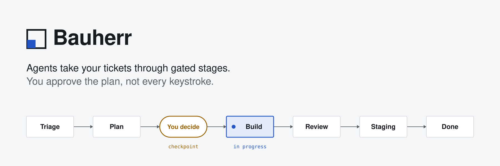
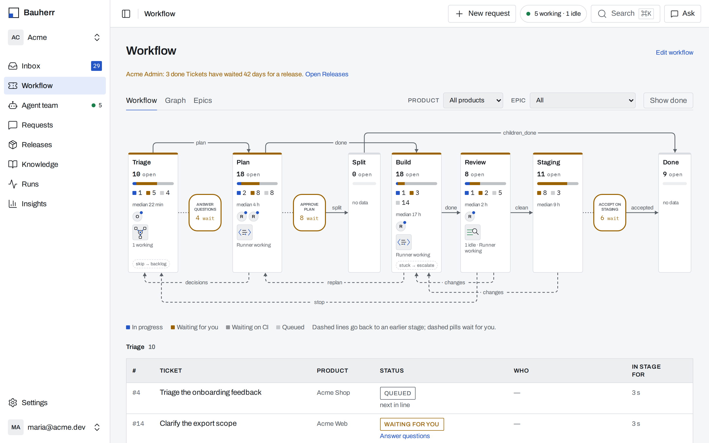
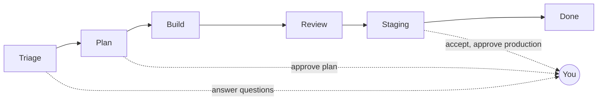
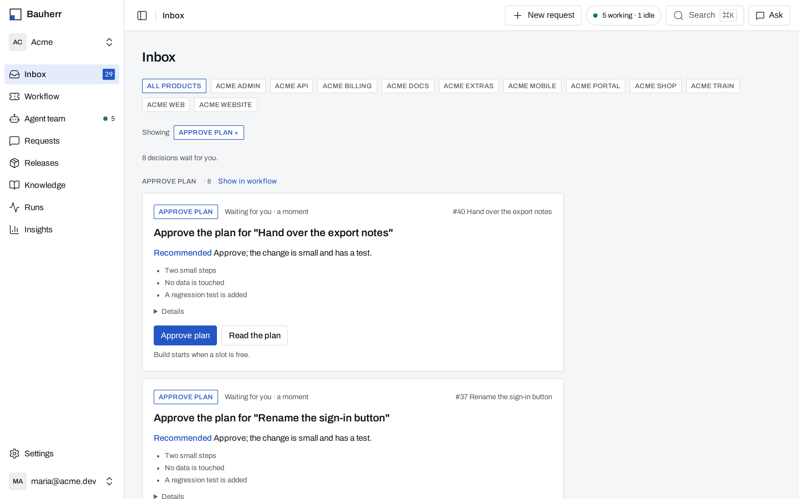
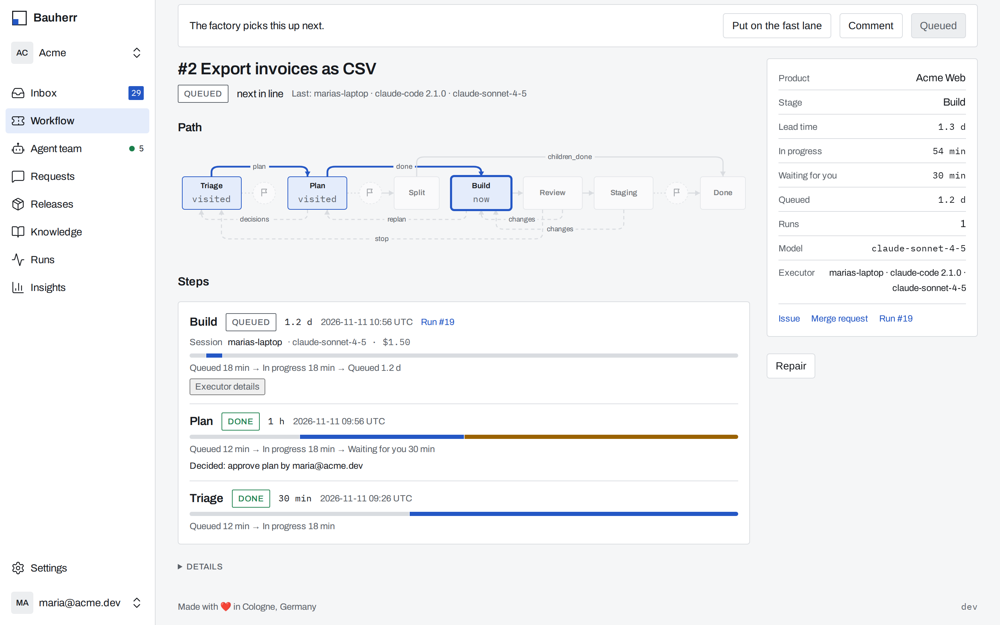
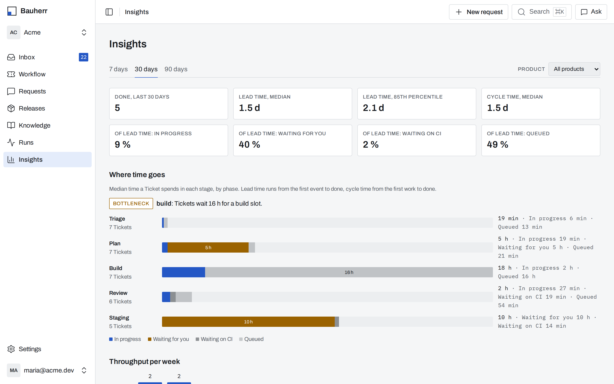
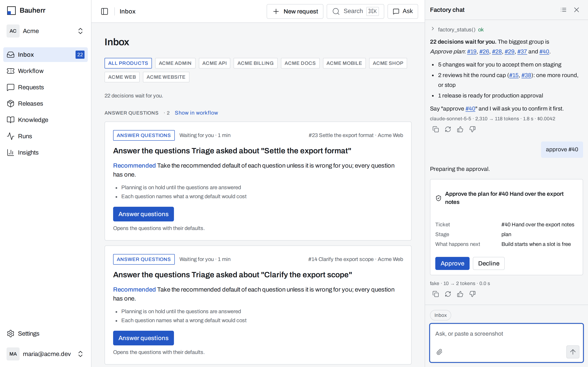
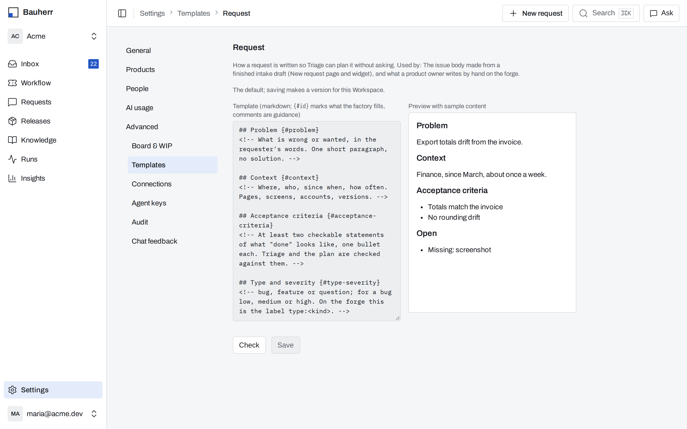
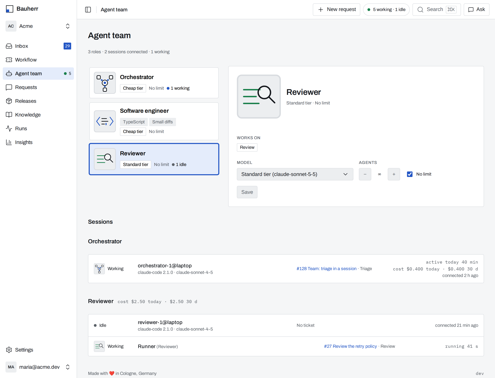

<div align="center">

<h1>Bauherr: an open-source AI software factory</h1>

<picture>
  <source media="(prefers-color-scheme: dark)" srcset="docs/assets/banner-dark.svg">
  
</picture>

**Agents take your tickets through gated stages. You approve the plan, not every keystroke.**<br>
Bauherr connects to the issue tracker and repositories you already use. Agents plan, build, review and release; you decide
at the checkpoints. Self-hosted, with an audit trail and a budget per Workspace.


[](https://github.com/getbauherr/bauherr/actions/workflows/ci.yml)
[](https://github.com/getbauherr/bauherr/releases/latest)
[](https://www.npmjs.com/package/bauherr)
[](https://getbauherr.dev/)
[](LICENSE)
[](https://www.typescriptlang.org/)
[](https://nextjs.org/)
[](https://payloadcms.com/)
[](https://www.postgresql.org/)
[](https://github.com/getbauherr/bauherr/pkgs/container/bauherr)
[](https://github.com/getbauherr/bauherr/pkgs/container/bauherr)
[](docs/session-mode.md)
[](https://docs.claude.com/en/docs/agent-sdk/overview)

[Why?](#-why-bauherr) •
[How it works](#-how-it-works) •
[Features](#-features) •
[Quick start](#-quick-start) •
[Status](#-status-and-roadmap) •
[FAQ](#-faq) •
[Contributing](#-contributing)

<picture>
  <source media="(prefers-color-scheme: dark)" srcset="docs/assets/screenshot-workflow-dark.png">
  
</picture>

</div>

> [!WARNING]
> **Pre-release.** Bauherr builds itself, but the data model and the workflow can still change between versions. Back up
> the database before you upgrade, and read what an agent proposes before you approve it.

## 💡 Why Bauherr?

*Bauherr* is German for the person who commissions a building and signs off on the work, not the one who lays the bricks.
That is the role you get.

- **You decide, the factory works.** Tickets move through stages by themselves. You are asked at a few checkpoints, and the Inbox shows each one as a prepared card: the ask, a recommendation, the facts and the real options.
- **Your tickets stay yours.** They live in GitHub. Bauherr keeps a pointer and what it derives, and writes the stage as a label.
- **Everything is on the record.** Runs, steps, tool calls, human touches and cost are stored. Every step of a Ticket shows who or what did it, with which model, for how much.
- **Cost is capped and measured.** Each Workspace has its own provider key and a rolling 30-day budget in a bundled gateway. An exhausted budget ends the Run. Your own coding sessions go through the same gateway with one pasted block per tool, so Insights shows tokens and cost per session, and prices update themselves ([docs/gateway.md](docs/gateway.md)).
- **Use your own session.** A stage can wait for your Claude Code to claim it, so you work in your own worktree with your own credentials.
- **Small to run.** Docker and Postgres 17. No Redis, no external service.

## 🔧 How it works

A Ticket moves through the stages in [`pack/factory.yaml`](pack/factory.yaml). Each stage has a kind and named outcomes: a failed review sends the Ticket back to Build, and a split plan turns it into a parent with sub-tickets.



| Kind | What happens |
|---|---|
| Triage | An agent checks the Ticket and asks what is unclear. You answer in a short chat with recommended defaults. |
| Plan | An agent writes the plan and a decision sheet. |
| Build | An agent implements the plan on a branch and opens a merge request with evidence: commands, exit codes, test results. |
| Review | A reviewer agent without memory of the change reads the diff. The factory merges when it is clean. |
| Staging | The Product's own CI deploys. The factory merges directly, through a queue or in a train. |
| Done | The Ticket is closed on merge. Release notes group done Tickets per release. |

By default the Product owner answers **Answer questions** and accepts on staging (**Accept on staging**, for a Product that has a Product owner who tests on staging), and you are asked at **Approve plan** and **Approve production**; where a Product has no Product owner, you are asked everything. Each checkpoint can be addressed to either of you in the workflow editor. Failed runs, failed releases and reviews at their round cap also land in the Inbox.

Each Workspace has one factory file (`factory.yaml`) for its team and workflow. You can add custom `agent` stages (a role works the Ticket and reports an outcome) and `human` stages (a person picks an outcome), and rename, remove or reorder stages. The outcomes route Tickets, and the custom stages show in the graph, the Inbox, Path and Steps and Insights. There is exactly one build, review and release chain. Stages, labels, triggers, retries and budgets: [docs/spec/workflow.md](docs/spec/workflow.md).

## ✨ Features

One row per area. The full list, with the page of each feature, is in [docs/features.md](docs/features.md).

| Area | What Bauherr does |
|---|---|
| 🗺️ [Workflow](docs/features.md#workflow) | The stages as a graph on the home page, one editable factory file per Workspace with custom agent and human stages, WIP limits, a fast lane for urgent bugs (an urgent request, or "Put on the fast lane" on a Ticket), overlap hold between Builds |
| 🎫 [Tickets](docs/features.md#tickets) | One status vocabulary, a Path through the stages, a Steps timeline with executor, model and cost, epics and sub-tickets |
| 📥 [Decisions](docs/features.md#decisions) | An Inbox of prepared decision cards for plans, staging, production and review round caps |
| 💬 [Chat](docs/chat.md) | A chat on every page that knows the page, stored threads, confirm cards for actions, pasted screenshots, answer feedback |
| 📝 [Requests](docs/intake-embed.md) | A request assistant in the app and an embeddable website widget that turn a wish into a Ticket |
| 🚀 [Releases](docs/features.md#releases) | Merge direct, through the forge's queue or in a train; release notes and shipping per Product |
| 🛡️ [Quality and security](docs/features.md#quality-and-security) | A review stage, pre-review checks, flaky-check tracking, a scheduled security scan, evidence on every merge request |
| 👥 [Team and sessions](docs/session-mode.md) | An Agent team page to pick roles with profiles, skills and models; sessions that connect as a role and pull work; who is working, on what, for how long; agent keys, people, OIDC sign-in |
| 📚 [Knowledge](docs/features.md#knowledge) | A repository of your documents and skills that agents search, and a pack of skills, rules and hooks per Run |
| 💶 [Models and cost](docs/gateway.md) | A bundled AI gateway that also measures your own coding sessions, self-updating prices, budgets, model tiers, cost per Product, Ticket and stage |
| 📈 [Insights](docs/features.md#models-and-cost) | Lead time, cycle time, time per stage with the bottleneck, throughput per week; [tokens and cost](docs/cost.md) per model, role, session, stage and Ticket |
| 🧾 [Audit](docs/observability.md) | Human touches and tool calls in the UI, metrics and traces in Prometheus and Jaeger |
| ⚙️ [Administration](docs/features.md#administration) | Workspaces, Products, Connections, editable text templates, a command palette |
| 🔌 [CLI and API](docs/features.md#cli-and-api) | `npx bauherr`, an MCP server, Payload's REST API, a Runner built on the Claude Agent SDK |

## 📸 Screenshots

<table>
  <tr>
    <td width="50%"><br><sub><b>Inbox</b>: each decision as a card with a recommendation</sub></td>
    <td width="50%"><br><sub><b>Ticket</b>: the path it took and who did each step</sub></td>
  </tr>
  <tr>
    <td width="50%"><br><sub><b>Insights</b>: where time goes, and the bottleneck</sub></td>
    <td width="50%"><br><sub><b>Chat</b>: ask, then confirm an action on a card</sub></td>
  </tr>
  <tr>
    <td width="50%"><br><sub><b>Templates</b>: edit the texts the factory writes, with a preview</sub></td>
    <td width="50%"><br><sub><b>Agent team</b>: pick a role, see who is working and who is idle</sub></td>
  </tr>
</table>

## 🚀 Quick start

Requires Docker with Compose and Node 22.14+. No clone, no build:

```bash
npx bauherr init
```

It asks for the install directory, port and public URL (`--yes` takes the defaults; `--dir`, `--port`, `--url` set them), writes `compose.yaml` and a mode-600 `.env` with generated secrets, starts the stack and opens the UI. It checks first that Docker is reachable and the port is free. Re-running `init` keeps the secrets; upgrade with `npx bauherr@latest init`. Other commands: `up`, `down` (`--volumes` deletes the data), `status`, `seed`, `eval`. A localhost public URL means polling mode, a public URL enables webhooks. Then sign in: the setup wizard takes you through five steps (connect your forge, pick a product, pick your team, connect a session, first request).

From a source checkout (Node 24 and pnpm 10 for local development):

```bash
git clone https://github.com/getbauherr/bauherr.git && cd bauherr
docker compose build && docker compose up -d
```

Both start `db` (Postgres 17), `gateway`, `app` (UI, API and MCP on `http://localhost:3000`), `worker` (agent Runs) and `poller` (Ticket polling); secrets are generated on first start.

Create the Admin user, the first Workspace and its Connections. The seed script creates Workspace `getbauherr` for the repository `getbauherr/bauherr`; further Workspaces, Products and Connections are added under Settings.

```bash
export GITHUB_TOKEN="$(gh auth token)" BAUHERR_ADMIN_EMAIL=<email>
docker compose run --rm --no-deps -T \
  -v ~/.config/bauherr/anthropic-key:/run/anthropic-key:ro -e ANTHROPIC_API_KEY_FILE=/run/anthropic-key \
  -v ~/.config/bauherr/admin-password:/run/admin-password:ro -e BAUHERR_ADMIN_PASSWORD_FILE=/run/admin-password \
  -e BAUHERR_ADMIN_EMAIL -e GITHUB_TOKEN app sh -c 'cd /repo/apps/server && pnpm seed'
```

Open `http://localhost:3000` and sign in. To start a Ticket, label it `bauherr:stage:plan` in the forge, or send a request from the app. A worked example with costs: [docs/first-run.md](docs/first-run.md).

## 🔌 Connect your own Claude Code session

Run stages from your laptop instead of the Runner. Create an agent key under **API key** in the user menu, then add the MCP server:

```bash
claude mcp add --transport http bauherr http://localhost:3000/mcp --header "Authorization: Bearer $(cat ~/.config/bauherr/mcp-key)"
```

The session lists the frontier, claims a Run, works in your worktree and finishes it with evidence. Agent keys cannot pass a human gate. Set the mode per stage and Workspace: [docs/session-mode.md](docs/session-mode.md).

## 🧑‍💻 Connect a session as a role

The factory file declares the roles (orchestrator, engineer, reviewer, security, UX, test): each has a profile, skills, a model or tier and an optional agent limit. A session joins as one role and pulls the Runs of the stages that name it. With the MCP line above in place, start Claude Code and say:

```text
Connect to the factory as engineer and work until told to stop.
```

The session calls `connect {role}`, then loops on `next_work` until nothing is queued for its role. It shows as Working, Idle or Offline with its active time. The orchestrator also receives stuck Tickets. The Ticket status and Steps name who works ("<session> (<role>)", "Runner" or "CI"), and the chat can answer who is working. Details: [docs/session-mode.md](docs/session-mode.md#connect-as-a-role).

## ⚙️ Configuration

| What | Where |
|---|---|
| `PORT`, `PUBLIC_URL`, `BAUHERR_ENABLE_ADMIN`, `OTEL_ENABLED` | environment or `.env` next to [`compose.yaml`](compose.yaml) |
| OIDC sign-in (`OIDC_ISSUER`, `OIDC_CLIENT_ID`, ...) | [docs/auth.md](docs/auth.md) |
| Run mode per stage (`BAUHERR_DEFAULT_MODE`, Workspace `modeByStage`) | [docs/session-mode.md](docs/session-mode.md) |
| Stages, roles, gates: one factory file per Workspace, edited in the workflow editor (Settings, Factory, Workflow), or applied with `bauherr apply -f factory.yaml --workspace <slug> [--dry-run]` (`bauherr export` prints the active file; `BAUHERR_FACTORY_FILE` applies one at boot; `GET`/`PUT /api/workspaces/<slug>/factory`) | [`pack/factory.yaml`](pack/factory.yaml) is the shipped default, [docs/spec/workflow.md](docs/spec/workflow.md) |
| Metrics and traces (Prometheus, Jaeger) | [docs/observability.md](docs/observability.md) |
| Gateway providers and model catalogs | [`deploy/gateway/`](deploy/gateway) |
| Budgets, model tiers, Connections | Settings in the UI (Factory › Models & budget, Workspace › Connections) |
| Provider credentials and data flows | [docs/legal.md](docs/legal.md) |

## 🏗️ Architecture

TypeScript monorepo (pnpm workspaces, Node 24). Glossary: [CONTEXT.md](CONTEXT.md).

| Path | Content |
|---|---|
| [`apps/server`](apps/server) | Payload 3 on Next.js: UI at `/`, API at `/api`, MCP at `/mcp`, jobs for the worker and poller, migrations, seeds, e2e tests |
| [`packages/adapters`](packages/adapters) | Forge and Ticket source contracts with the GitHub driver |
| [`packages/runner`](packages/runner) | Runs one stage with the Claude Agent SDK: shallow clone, localhost credential proxy, hooks, evidence |
| [`packages/cli`](packages/cli) | The `bauherr` npm package |
| [`pack`](pack) | Open-source core pack: skills, rules, hooks and the workflow |
| [`deploy`](deploy) | Gateway config template, model catalogs, database init |
| [`docs`](docs) | Spec, UI, auth, legal notes, research, design system |

```bash
pnpm install
pnpm typecheck   # builds the packages, then type-checks all of them
pnpm test        # needs the compose `db` service on 127.0.0.1:54330
```

## 🧭 Status and roadmap

Pre-release. The factory builds Bauherr itself. Every feature with its page: [docs/features.md](docs/features.md).
- **Live:** the Workflow graph, one factory file per Workspace with custom agent and human stages and plan approval on by default, agent roles and sessions that connect as a role, the Agent team page (pick roles, see live sessions and who works where), the five-step setup wizard with team presets (Solo, Standard, Careful), plain-word progress comments on the issue, Tickets with Path and Steps, the Inbox with prepared decisions, editable templates, Insights, the docked chat, requests and the website widget, the knowledge repo, self-review and merge, release train and notes, security scan, fast lane, request card with types and the Requests workbench, WIP limits, AI gateway with budgets, audit, OIDC.
- **Planned:** a GitLab driver, notifications at checkpoints ([#77](https://github.com/getbauherr/bauherr/issues/77)), provider auth beyond API keys ([#80](https://github.com/getbauherr/bauherr/issues/80)).

Every decision is tracked in [Bauherr v0.1: way to a locked architecture and spec (#1)](https://github.com/getbauherr/bauherr/issues/1). Releasing: [docs/releasing.md](docs/releasing.md).

## ❓ FAQ

<details>
<summary><b>What does it cost?</b></summary>

The software is free (Apache-2.0). You pay your model provider. Every Workspace has a budget per 30 days in the gateway, and a Run that exhausts it ends. Cost per Product, Ticket and stage is under Settings, Factory, AI usage.
</details>

<details>
<summary><b>Which models and providers can it use?</b></summary>

Stages pick a tier (`cheap`, `standard`, `strong`); the Workspace maps each tier to a model. The Runner uses Claude Code through the Claude Agent SDK. The gateway fronts the provider you configure under Connections. Credentials must be API keys, see [docs/legal.md](docs/legal.md).
</details>

<details>
<summary><b>Where do my code and tickets live?</b></summary>

In your forge. Agents work in a fresh shallow clone and open a merge request. Bauherr stores pointers, derived state, the audit trail and cost in its own Postgres. It never owns a Ticket.
</details>

<details>
<summary><b>What leaves my server?</b></summary>

Prompts and the code an agent reads go to the model provider you configured, and requests go to your forge. The gateway stores no prompts. Tool calls are stored as argument names and a hash, never payloads. Details: [docs/legal.md](docs/legal.md).
</details>

<details>
<summary><b>Does it work with GitLab?</b></summary>

Not yet. GitHub Issues and GitHub repositories are the supported forge. The GitLab driver is designed ([research](docs/research/gitlab-driver.md)) and not built.
</details>

<details>
<summary><b>How do I stay in control?</b></summary>

By default you answer the questions Triage cannot settle, approve every plan and approve production. Staging acceptance is optional, and the factory file can drop a gate. Agent keys cannot pass a human gate, and every human decision is recorded with your email.
</details>

<details>
<summary><b>How do I stop a Run?</b></summary>

Open the Run under Runs (Admin) and use **Release lock**. A review that hits its round cap waits in the Inbox: give one more round, or stop. An exhausted budget also ends a Run.
</details>

## 🤝 Contributing

Open an issue before large changes. No CLA and no sign-off; contributions are Apache-2.0. See [CONTRIBUTING.md](CONTRIBUTING.md). Report vulnerabilities as described in [SECURITY.md](SECURITY.md), not in public issues.

## 📄 Licence

[Apache-2.0](LICENSE); third-party notices in [NOTICE](NOTICE). Bauherr runs Claude Code via the Claude Agent SDK, which is under Anthropic's Commercial Terms. Every Workspace must bring its own provider credential and API keys only; operators should read [docs/legal.md](docs/legal.md). Not legal advice.
