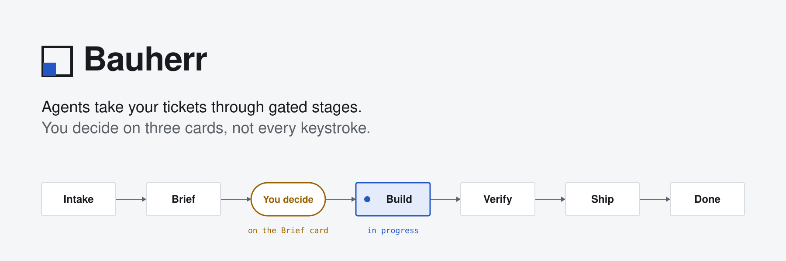
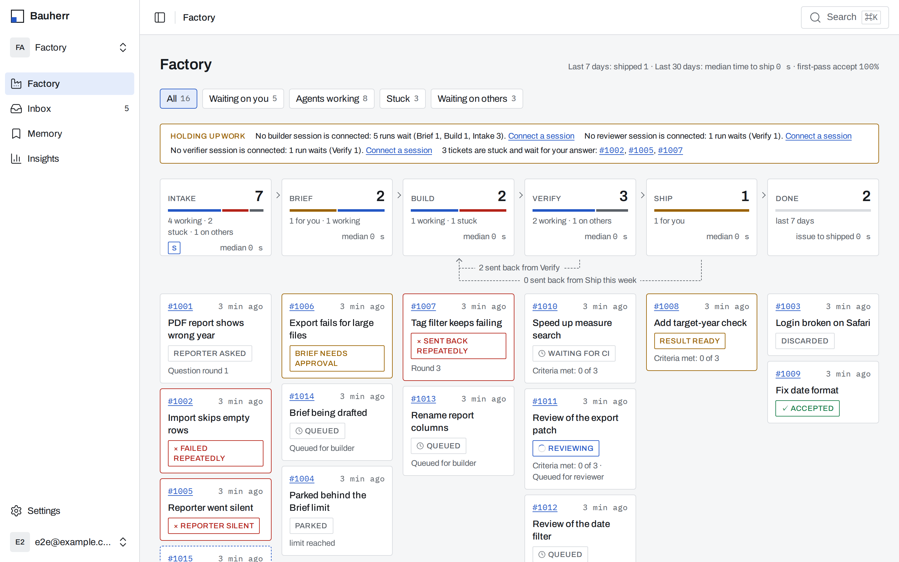
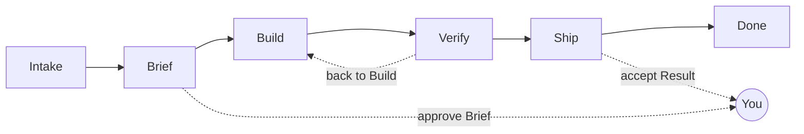
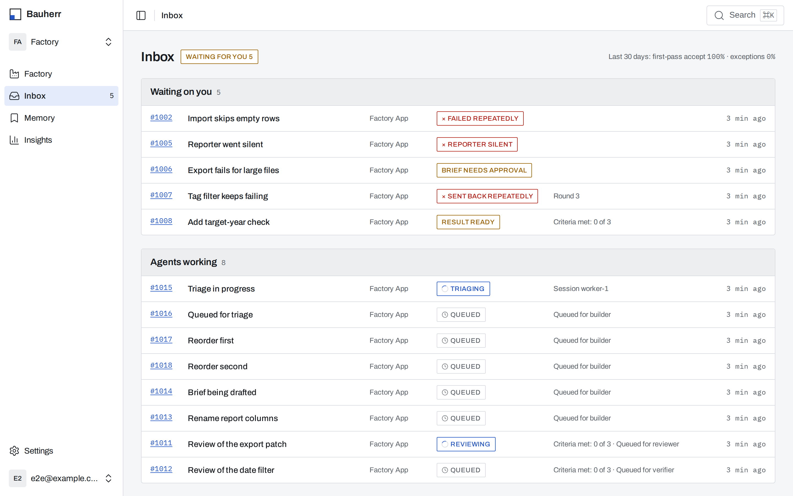
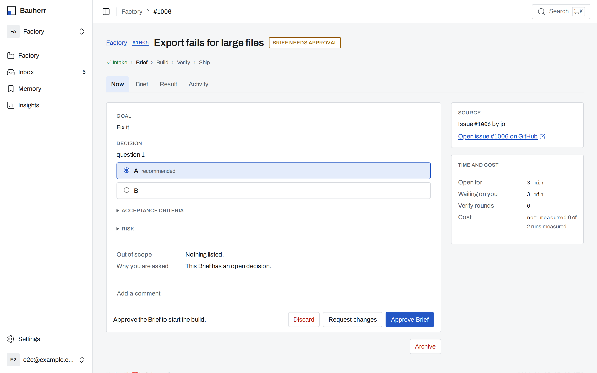
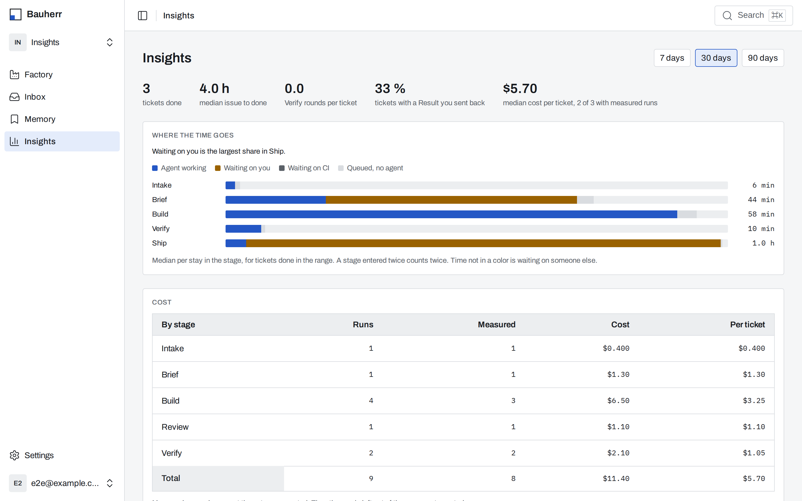
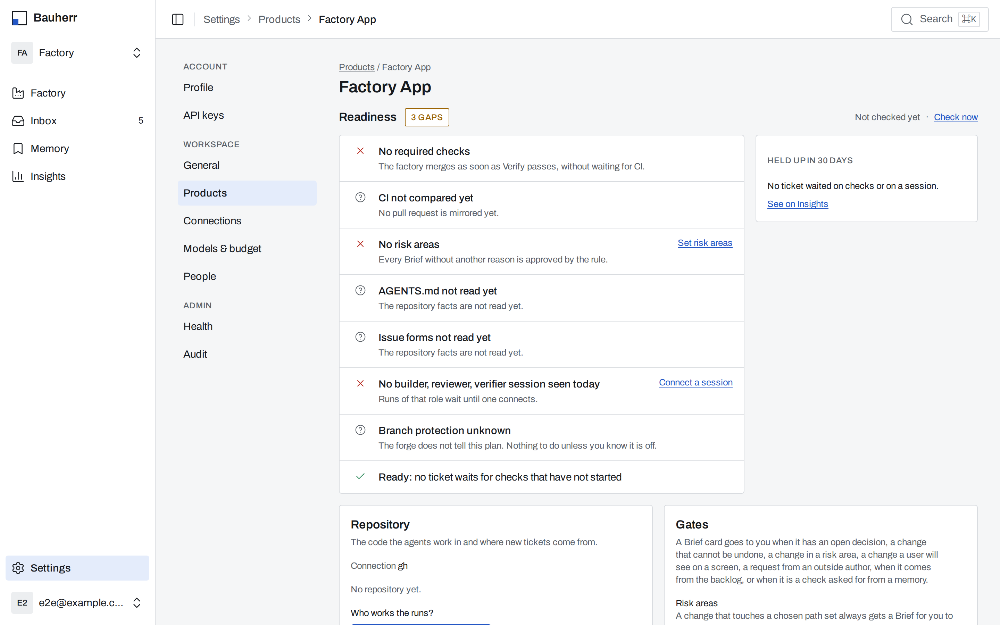

<div align="center">

<h1>Bauherr: an open-source AI software factory</h1>

<picture>
  <source media="(prefers-color-scheme: dark)" srcset="docs/assets/banner-dark.svg">
  
</picture>

**Agents take your tickets from issue to verified pull request. You decide on three cards.**<br>
Bauherr connects to the forge you already use. Agents write a Brief, build, review and verify. You approve the Brief,
accept the Result and answer Questions. Self-hosted, with an audit trail and a budget per Workspace.


[](https://github.com/getbauherr/bauherr/actions/workflows/ci.yml)
[](https://github.com/getbauherr/bauherr/releases/latest)
[](https://www.npmjs.com/package/bauherr)
[](https://getbauherr.dev/)
[](LICENSE)
[](https://www.typescriptlang.org/)
[](https://nextjs.org/)
[](https://payloadcms.com/)
[](https://www.postgresql.org/)
[](https://github.com/getbauherr/bauherr/pkgs/container/bauherr)
[](https://github.com/getbauherr/bauherr/pkgs/container/bauherr)

[](https://docs.claude.com/en/docs/agent-sdk/overview)

[Why?](#-why-bauherr) •
[How it works](#-how-it-works) •
[Screens](#-screens) •
[Quick start](#-quick-start) •
[Status](#-status-and-roadmap) •
[FAQ](#-faq) •
[Contributing](#-contributing)

<picture>
  <source media="(prefers-color-scheme: dark)" srcset="docs/assets/screenshot-factory-dark.png">
  
</picture>

</div>

> [!WARNING]
> **Pre-release.** Bauherr builds itself, but the data model can still change between versions. Back up the database
> before you upgrade, and read what an agent proposes before you approve it.

## 💡 Why Bauherr?

*Bauherr* is German for the person who commissions a building and signs off on the work, not the one who lays the bricks.
That is the role you get.

- **You decide on three cards.** Brief, Result and Question. Each shows the ask, a recommendation and the real options, and takes a free comment.
- **Low risk goes through.** A rule in code approves a Brief with no open decision, no one-way door, no risk area and no visible change.
- **Pictures first.** A Brief for a visible change carries mockups. A Result shows before and after per screen.
- **Nobody checks their own work.** A review run and a verifier run check every patch. Neither built it, and the server refuses a verdict without proof per criterion.
- **Your tickets stay in your forge.** GitHub or GitLab is mirrored into the factory database, which is the truth for factory state. One module writes to the forge.
- **Cost is measured.** Every agent request passes through a bundled gateway with the Workspace's own provider key and budget. Insights shows time and cost per ticket.
- **Small to run.** Docker and Postgres 17.

## 🔧 How it works

A ticket moves through six fixed stages. Three roles work them: builder, reviewer and verifier.



| Stage | What happens |
|---|---|
| Intake | Code selects the issue. A model checks it and asks the reporter one numbered round of questions when something is missing. |
| Brief | The builder writes the goal, up to seven criteria a user can observe, the risk and the plan. You approve it, or the risk rule does. |
| Build | The builder implements the Brief and opens a pull request. |
| Verify | A reviewer reads the diff. Then a verifier checks each criterion against proof. |
| Ship | The factory merges. You accept the Result. Production approval is a switch per Product. |
| Done | The ticket is closed. |

Three verify rounds, two reporter rounds and two failed runs are the caps. Then the ticket stops on a Question card. **Back to Brief** returns a ticket from Build or Verify with a note.

Agents run as Claude Code sessions over MCP, or in the headless Runner. A Product picks one executor.

**Memory** is three markdown documents: factory, workspace and product. Parts of them go to each run. Only you or a Retro change them. A Retro is a conversation about a range of tickets that proposes changes; you apply or drop each one.

**Bring a project you already have.** Connect the repositories, import all issues and open pull requests, take a first look, then switch on. Nothing is written to the forge until you switch on. An open pull request that closes an issue and comes from a trusted author enters at Verify.

Glossary: [CONTEXT.md](CONTEXT.md). Standing on the shoulders of others: [Credits](docs/references.md).

## 📸 Screens

<table>
  <tr>
    <td width="50%"><br><sub><b>Inbox</b>: who has to act</sub></td>
    <td width="50%"><br><sub><b>Ticket</b>: the card that waits for you</sub></td>
  </tr>
  <tr>
    <td width="50%"><br><sub><b>Insights</b>: where time and money go</sub></td>
    <td width="50%"><br><sub><b>Repo readiness</b>: fix the gaps first</sub></td>
  </tr>
</table>

## 🚀 Quick start

Requires Docker with Compose and Node 22.14+. No clone, no build:

```bash
npx bauherr init
```

It asks for the install directory, port and public URL (`--yes` takes the defaults; `--dir`, `--port`, `--url` set them), writes `compose.yaml` and a mode-600 `.env` with generated secrets, starts the stack and opens the UI. It checks first that Docker is reachable and the port is free. Re-running `init` keeps the secrets; upgrade with `npx bauherr@latest init`. Other commands: `up`, `down` (`--volumes` deletes the data), `status`, `seed`, `pack lint`. A localhost public URL means polling mode, a public URL enables webhooks.

From a source checkout (Node 24 and pnpm 10 for local development):

```bash
git clone https://github.com/getbauherr/bauherr.git && cd bauherr
docker compose build && docker compose up -d
```

Both start `db` (Postgres 17), `gateway`, `app` (UI, API and MCP on `http://localhost:3000`), `worker` (agent runs) and `poller` (forge polling). Secrets are generated on first start.

Create the Admin user, the first Workspace and its Connections. The seed script creates Workspace `getbauherr` for the repository `getbauherr/bauherr`. Further Workspaces, Products and Connections are added under Settings.

```bash
export GITHUB_TOKEN="$(gh auth token)" BAUHERR_ADMIN_EMAIL=<email>
docker compose run --rm --no-deps -T \
  -v ~/.config/bauherr/anthropic-key:/run/anthropic-key:ro -e ANTHROPIC_API_KEY_FILE=/run/anthropic-key \
  -v ~/.config/bauherr/admin-password:/run/admin-password:ro -e BAUHERR_ADMIN_PASSWORD_FILE=/run/admin-password \
  -e BAUHERR_ADMIN_EMAIL -e GITHUB_TOKEN app sh -c 'cd /repo/apps/server && pnpm seed'
```

Open `http://localhost:3000`, sign in, add a Product and follow its connect page.

## 🔌 Connect your own Claude Code session

Run the roles from your laptop instead of the Runner. Create an agent key under **API keys** in the user menu, then add the MCP server:

```bash
claude mcp add --transport http bauherr http://localhost:3000/mcp --header "Authorization: Bearer $(cat ~/.config/bauherr/mcp-key)"
```

Start Claude Code and say:

```text
Connect to the factory as builder and work until told to stop.
```

The session calls `connect` with a role (builder, reviewer or verifier), then loops on `next_work`. It shows as working, idle or offline. Agent keys cannot decide a card. The tools are `connect`, `next_work`, `heartbeat`, `search`, `attach_proof`, `fetch_file`, `ask`, `submit`, `release` and `decide`.

To work several tickets from one session, connect with a capacity of 1 to 4. For each run the session starts one subagent from `pack/agents/bauherr-builder.md` on the tier the context pack names, in its own worktree. A run that stops heartbeating is requeued.

## ⚙️ Configuration

| What | Where |
|---|---|
| `PORT`, `PUBLIC_URL`, `BAUHERR_ENABLE_ADMIN`, `OTEL_ENABLED` | environment or `.env` next to [`compose.yaml`](compose.yaml) |
| OIDC sign-in (`OIDC_ISSUER`, `OIDC_CLIENT_ID`, ...) | [docs/auth.md](docs/auth.md) |
| Gateway providers and model catalogs | [`deploy/gateway/`](deploy/gateway), [docs/gateway.md](docs/gateway.md) |
| Roles and their model tiers, rules, skills | [`pack/`](pack) |
| Budgets, tiers, Connections | Settings in the UI |
| Gates, intake and proof per Product | the Product page under Settings, Products |
| Provider credentials and data flows | [docs/legal.md](docs/legal.md) |

## 🏗️ Architecture

TypeScript monorepo (pnpm workspaces, Node 24). Glossary: [CONTEXT.md](CONTEXT.md).

| Path | Content |
|---|---|
| [`apps/server/src/core`](apps/server/src/core) | The lifecycle core: record, engine, gate, mirror, forge writer, runs, memory |
| [`apps/server/src/modules`](apps/server/src/modules) | One lifecycle module each: intake, brief, build, review, verify |
| [`apps/server`](apps/server) | Payload 3 on Next.js: UI at `/`, API at `/api`, MCP at `/mcp`, jobs, migrations, e2e tests |
| [`packages/adapters`](packages/adapters) | GitHub, GitLab and fake forge |
| [`packages/runner`](packages/runner) | Runs one role with the Claude Agent SDK: shallow clone, credential proxy, hooks |
| [`packages/cli`](packages/cli) | The `bauherr` npm package |
| [`pack`](pack) | Open-source core pack: roles, rules and skills |
| [`deploy`](deploy) | Gateway config template, model catalogs, database init |
| [`docs`](docs) | UI guide, auth, legal notes, research, design system |

```bash
pnpm install
pnpm typecheck   # builds the packages, then type-checks all of them
pnpm lint        # rules in eslint.config.mjs
pnpm test        # needs the compose `db` service on 127.0.0.1:54330
```

The rules are checks, not prose: see [AGENTS.md](AGENTS.md).

## 🧭 Status and roadmap

Pre-release. The factory builds Bauherr itself.
- **Live:** the lifecycle from Intake to Done with three roles, the three cards, the risk rule, Back to Brief, mockups in the Brief, before and after in the Result, the Factory view, Inbox, ticket page, Insights, Repo readiness, Memory as three documents with Retro, onboarding of existing projects, the bundled gateway with budgets, GitHub and GitLab, OIDC.
- **Planned:** ticket relations ([#939](https://github.com/getbauherr/bauherr/issues/939) to [#943](https://github.com/getbauherr/bauherr/issues/943)), requests from Product owners ([#840](https://github.com/getbauherr/bauherr/issues/840) to [#848](https://github.com/getbauherr/bauherr/issues/848)) and releases ([#922](https://github.com/getbauherr/bauherr/issues/922) to [#929](https://github.com/getbauherr/bauherr/issues/929)).

## ❓ FAQ

<details>
<summary><b>What does it cost?</b></summary>

The software is free (Apache-2.0). You pay your model provider. Every Workspace has a budget in the gateway, and a run that exhausts it ends. Insights shows cost per ticket, stage, model and role.
</details>

<details>
<summary><b>Which models and providers can it use?</b></summary>

Roles pick a tier (`cheap`, `standard`, `strong`) in `pack/pack.yaml`. The Workspace maps each tier to a model. The Runner uses Claude Code through the Claude Agent SDK. The gateway fronts the provider you configure under Connections. Credentials must be API keys, see [docs/legal.md](docs/legal.md).
</details>

<details>
<summary><b>Where do my code and tickets live?</b></summary>

In your forge. Agents work in a fresh shallow clone and open a pull request. Bauherr mirrors issues, comments, pull requests and checks into its own Postgres, which is the truth for factory state. It writes to the forge through one module.
</details>

<details>
<summary><b>What leaves my server?</b></summary>

Prompts and the code an agent reads go to the model provider you configured, and requests go to your forge. The gateway stores no prompts. Details: [docs/legal.md](docs/legal.md).
</details>

<details>
<summary><b>Does it work with GitLab?</b></summary>

Yes. A GitLab Connection works next to GitHub. GitLab cannot report required checks, so Repo readiness shows that row as unknown.
</details>

<details>
<summary><b>How do I stay in control?</b></summary>

You approve every Brief the risk rule does not approve and accept every Result. Production approval is a switch per Product. Agent keys cannot decide a card.
</details>

<details>
<summary><b>How do I stop a run?</b></summary>

A ticket that fails twice or uses up its verify rounds stops on a Question card: retry, give one more round or discard. Archive hides a ticket and releases its run.
</details>

## 🤝 Contributing

Open an issue before large changes. No CLA and no sign-off; contributions are Apache-2.0. See [CONTRIBUTING.md](CONTRIBUTING.md). Report vulnerabilities as described in [SECURITY.md](SECURITY.md), not in public issues.

## 📄 Licence

[Apache-2.0](LICENSE); third-party notices in [NOTICE](NOTICE). Bauherr runs Claude Code via the Claude Agent SDK, which is under Anthropic's Commercial Terms. Every Workspace must bring its own provider credential and API keys only; operators should read [docs/legal.md](docs/legal.md). Not legal advice.
